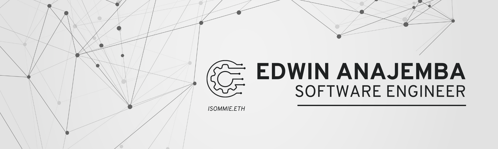

# Hi, I'm Edwin Anajemba 👋

**Product engineer and team lead.** I lead the product team at [JointEarn](https://www.jointearn.com) and build the web platforms and cloud infrastructure behind products, from payments to Web3. Based in Lagos, Nigeria, working with teams anywhere.

**Open to contracts.** Full portfolio, services and contact form: **[anajembaedwin.github.io](https://anajembaedwin.github.io)**

---

### What I do

- 🧭 **Lead product builds**: scope, architecture, team, delivery and the infrastructure it runs on.
- 🌐 **Web platforms and APIs**: React and Next.js frontends, Node.js/TypeScript and Python backends on PostgreSQL.
- ☁️ **Cloud and infrastructure**: AWS, Docker and CI/CD that make releases routine and production observable.
- 💳 **Payments, Web3 and AI**: checkout and payment flows, Solidity contracts on Polygon, and features built on the Claude API.

### Live products I've contributed to

| Product | What it is | My part |
| --- | --- | --- |
| [JointEarn](https://www.jointearn.com) | Rewards platform: earn from videos, games, news and shopping | Lead the product team; own the React frontend and Node.js/TypeScript backend |
| [Eyemark](https://www.eyemark.ng) | Nigeria's platform for following government projects | Worked on the web app |
| [CloseCarbon](https://netzence.com/closecarbon/) (Netzence) | Carbon emissions verification | Hyperledger smart contracts, Python (FastAPI) backend and APIs |
| [Cruva](https://www.cruva.com) (formerly UpTk) | Marketplace, now an AI platform for TikTok Shop affiliates | Buyer and merchant workflows in Vue.js; AWS deployments |
| [GirlLEAD Talent Accelerator](https://thegirlleadproject.org) | Non-profit talent accelerator | Volunteer: backend architecture, product requirements, migration plan |

Earlier: **Palimart** (e-commerce, 2021 to 2024, catalog, orders and payments) and **Maxxed Technical Systems** (enterprise SaaS backend).

### Things I'm building

- 🎮 **[Games](https://anajembaedwin.github.io/games)**: [Daily Bug Hunt](https://anajembaedwin.github.io/games/daily-bug-hunt/play), a daily developer puzzle, and Tiny Wars, a tiny-people war game.
- 🧪 Open-source projects and experiments in the repositories below.

---

### Stack

AWS: App Runner, ECR, S3, RDS, SES · Web3: Solidity on Polygon, Hyperledger · AI: Claude API

---

### Let's work together

- 🌍 Portfolio: [anajembaedwin.github.io](https://anajembaedwin.github.io)
- 💬 Contact form: [anajembaedwin.github.io/#contact](https://anajembaedwin.github.io/#contact)
- 💼 LinkedIn: [linkedin.com/in/anajembaedwin](https://www.linkedin.com/in/anajembaedwin)