

<a href="https://anajembaedwin.github.io"></a>


## What I do for teams

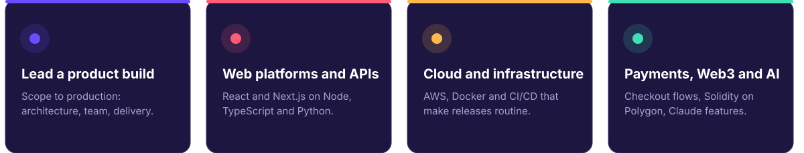

## How I ship

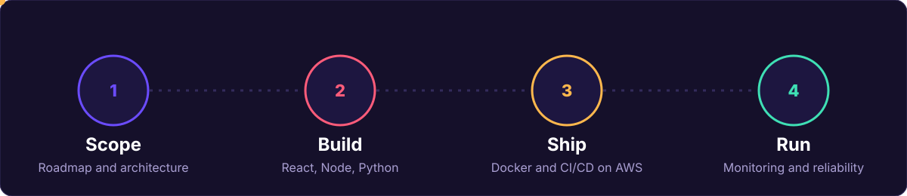

## Live products I've contributed to

<table>
<tr>
<td><a href="https://www.jointearn.com"></a></td>
<td><a href="https://www.eyemark.ng"></a></td>
<td><a href="https://netzence.com/closecarbon/"></a></td>
</tr>
<tr>
<td><a href="https://www.cruva.com"></a></td>
<td><a href="https://thegirlleadproject.org"></a></td>
<td></td>
</tr>
</table>

Earlier: three years owning the backend of the Palimart e-commerce platform (2021 to 2024), plus work at Maxxed Technical Systems.

## Stack


## Built for fun

<table>
<tr>
<td><a href="https://anajembaedwin.github.io/games/daily-bug-hunt/play"></a></td>
<td><a href="https://anajembaedwin.github.io/games/tiny-wars"></a></td>
</tr>
</table>

